  <picture>
    <source media="(prefers-color-scheme: dark)" srcset="./assets/header.svg" />
    <source media="(prefers-color-scheme: light)" srcset="./assets/header-light.svg" />
    
  </picture>

I am a Backend & Software Developer at CodeCore Dynamics LLC, based in Bandung, Indonesia. My work covers the full range of backend development. Since 2024, I have also built Farcaster mini apps and on-chain automation on Base, Arbitrum, and Polygon.

## Tools

  
<b>Resume</b>

### Experience

- **Backend & Software Developer**, CodeCore Dynamics LLC · Oct 2026 – Present · Remote
- **Web3 Developer**, Farcaster and on-chain bounties · 2024 – Present · Remote
- **Backend Developer**, PTIPD UIN Sunan Gunung Djati, Bandung · Jun 2022 – Jan 2023
- **IT Intern**, Politeknik Pos Indonesia · Jan 2018 – Mar 2018

### Education

- **Bachelor of Informatics Engineering (S1)**, UIN Sunan Gunung Djati, Bandung
- **Software Engineering**, SMKN 1 Lemahsugih · 2016 – 2019

  
    
  

